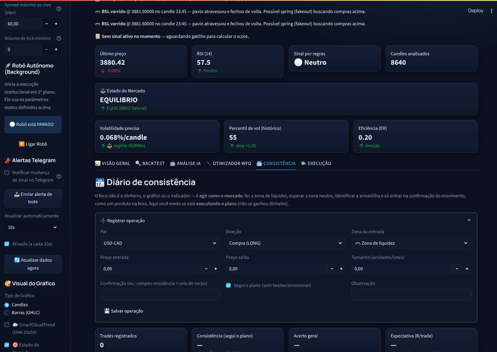
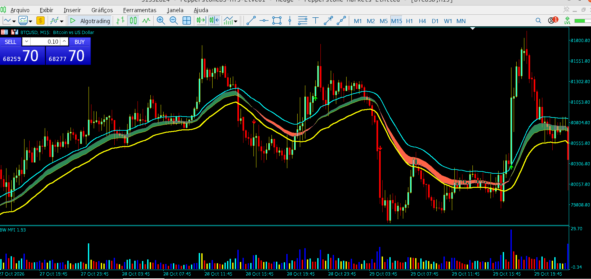
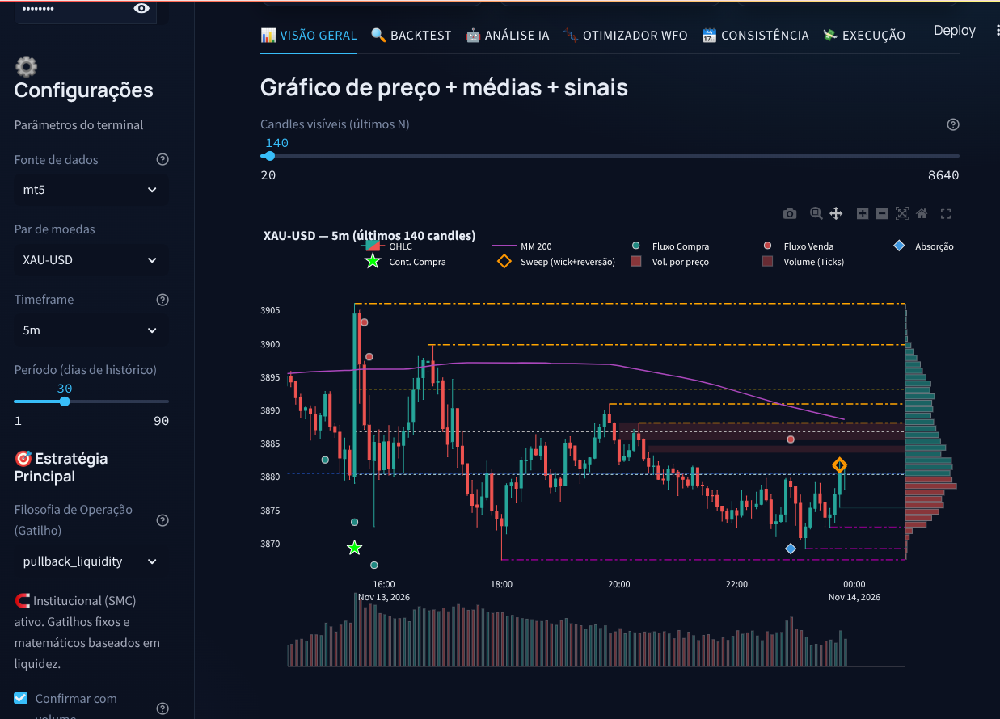

# Forex Dashboard

## Screenshots







## Aviso importante antes de operar com dinheiro real

Este dashboard **não garante lucro**. O backtest com custo real (spread) faz
parte do app e mostra, para os parâmetros atuais e dados recentes, resultados
marginais ou negativos para boa parte das configurações — a estratégia muitas
vezes perde para o custo da operação. Qualquer sistema que ignore
spread/slippage superestima resultados.

Leia o expander "⚠️ Leia antes de operar com dinheiro real" dentro do app.

## Mudanças importantes (v4)

### ✋ Inteligência Artificial (IA narrativa) DESLIGADA
A chamada à API OpenAI (parecer narrativo) foi **removida por decisão do
usuário** para não gerar custo de tokens:
- `llm_parecer()` em `ai_analysis.py` agora é um no-op que **nunca** chama a API.
- As métricas **locais** (Monte Carlo, VaR, P(TP/SL)) continuam rodando 100%
  offline, sem custo.
- A sidebar do app inicia com a análise de risco IA **desligada**.

## Fonte de dados: AwesomeAPI (tempo real)

O app agora usa como padrão a **AwesomeAPI** (`https://awesomeapi.com.br`) para
cotação e análise em tempo real:

- **Cotação ao vivo** (bid/ask, máx/mín do dia) no topo do dashboard.
- **Candles reais** montados a partir de ticks de ~1 min nos timeframes
  `1m/5m/15m/30m/1h` e fechamento diário no `1d` — sem o problema do Yahoo,
  que não entrega forex intradiário confiável.
- **Sem cache** enquanto a API key estiver configurada (sem chave, a API usa
  cache de 1 minuto — o app segue funcionando).

Para usar sua chave, coloque em `.streamlit/secrets.toml`:

```toml
awesomeapi_key = "sk_..."
```

A chave fica em `https://awesomeapi.com.br/account#keys`. O arquivo
`secrets.toml` está no `.gitignore` — **nunca suba a chave para o GitHub**.

### Como rodar

```bash
pip install -r requirements.txt

# configurar senha e chave (obrigatório)
cp .streamlit/secrets.toml.example .streamlit/secrets.toml
# edite .streamlit/secrets.toml: TROQUE a senha padrão e adicione awesomeapi_key

# rode local (recomendado para segurança)
streamlit run app.py --server.address 127.0.0.1 --server.port 8501
```

### ☁️ Deploy no Render (gratuito)

O `Dockerfile` + `entrypoint.sh` + `render.yaml` já estão no repo (repo **privado** é
suportado no Render). O dashboard roda em container Linux **sem MetaTrader** — os
dados em tempo real vêm da AwesomeAPI e a execução manual usa o modo demo; a
ponte MT5 fica desligada no container (é lazy e cai em try/except silenciosamente).

1. No [render.com](https://render.com) → **New +** → **Web Service** → conecte o
   GitHub → selecione `Mercado_Trader`.
2. O Render detecta o `Dockerfile` (runtime `docker`). O `render.yaml` já define
   o plano `free`, healthcheck em `/` e as variáveis.
3. Vá em **Environment** → **Environment Variables** e defina (vazias = desligadas):
   ```bash
   APP_PASSWORD="sua_senha_forte"      # OBRIGATÓRIO se quiser autenticação no app
   AWESOMEAPI_API_KEY="sua_chave"      # opcional; sem ela usa cache de 1 min
   TELEGRAM_TOKEN="123:ABC"            # opcional — alertas
   TELEGRAM_CHAT="123456789"           # opcional — alertas
   ```
   O `entrypoint.sh` gera `.streamlit/secrets.toml` a partir dessas variáveis no
   boot. **Nunca** coloque `secrets.toml` real dentro do repo.
4. Sobe sozinho na porta `$PORT` (Render injeta). Healthcheck em `/` e reinício
   em falha automático.

> ⚠️ Plano **free** do Render pausa o serviço após ~15 min sem acesso (acorda no
> próximo clique, levando ~1 min para subir). Se quiser sempre-ativo, use o plano
> Starter (~US$7/mês) ou um VPS.

> ⚠️ O robô MT5 (`run_trader.sh`) e a execução real continuam rodando **só na sua
> máquina Windows** — o cloud é somente o painel de análise + sinais por regras.

Na sidebar você pode alternar entre **awesomeapi** (padrão, tempo real) e
**yfinance** (Yahoo Finance, cache de 1h).

## Mudanças importantes (v5) — estratégias avançadas e gestão de risco

Versão focada em **novas técnicas de entrada**, **otimização** e **proteção de
conta**. Tudo isso está no dashboard; nada aqui muda a filosofia honesta: só
vale operar configuração que sobrevive ao backtest **com spread** e ao WFO.

### ⛩️ Técnica Fimathe (abertura de Tóquio)

Estratégia de **fatiamento de canal**, inspirada na Fimathe: o canal de
referência (CR) é traçado nos primeiros `Duração` candles após a `Hora de
abertura` (padrão 20h UTC = Tóquio), e a entrada ocorre no **rompimento** desse
canal, sempre no viés do SMA 200 (tendência).

- **SL/TP dinâmicos por tamanho de canal**: SL = 2 canais, TP = 2 canais a
  partir da entrada. Se o CR ficar maior que `Max Tamanho (pips)`, ele é
  **fatiado ao meio** para reduzir o risco (SL mais curto).
- Configurações na sidebar → `⛩️ Configurações Fimathe` (`fimathe_hour`,
  `fimathe_candles`, `fimathe_max_pips`).
- Gatilho: `trigger_mode = "fimathe_tokio"`.
- ⚠️ **Validação honesta**: quando o Fimathe está ativo, a **execução demo usa o
  mesmo SL/TP do backtest** (`Suggested_SL`/`Suggested_TP`). O broker
  (`PaperBroker`/`Mt5Broker`) recebe esses stops — antes da correção ele usava
  SL/TP por ATR e a demo não reproduzia a estratégia.

### 🥇 Estratégia de cruzamento MM3/MM9/MM20

Gatilho `3_9_20`: **MM3 cruza a MM9** **com** inclinação da MM20 a favor e
velas inteiras (candles) acima/abaixo de MM9+MM20 antes do cruzamento — filtro
de continuidade de tendência.

### 🎯 Stop Gain em Pips

O take profit pode ser definido **em pips** (padrão 100p) em vez de múltiplos
de ATR — modo `Take Profit → Pips` na sidebar. Correção: o `pip_size` correto
do par agora é propagado para o broker (XAU usa 0.01, JPY 0.01, majors 0.0001),
senão o TP em pips saía 100× errado para ouro.

### 🛑 Trailing Stop

Habilite `Ativar Trailing Stop` na sidebar: o SL acompanha o preço a N pips de
distância (bloqueia a perda de um ganho já conquistado). Funciona no backtest,
na execução demo e no robozinho do MT5.

### 📈 Gestão de Risco Dinâmica (Kelly Fracionado via IA)

`Gestão de Risco Dinâmica` na sidebar: quando ligada, o **% de risco por trade
é ajustado pela margem de confiança do ML** — trades com sinal "mais claro"
recebem mais lote (multiplicador entre 0.5× e 2.0× do risco base).

### 🧬 Otimizador WFO (Walk-Forward Optimization)

Aba **🧬 Otimizador WFO** no dashboard (e `optimize.py` standalone):

- Divide o histórico em **60% treino + 40% teste** (fora-da-amostra).
- Varre a grade de parâmetros (RSI, cruzamento, sessão, ADX, SL/TP ×ATR) no
  treino e **só sobrevive** quem mantém expectativa positiva no teste que nunca
  viu.
- Quem brilha no treino e morre no teste = overfitting → descartado.

```bash
python3 optimize.py --symbol XAU-USD --interval 5m --spread 25 --pip 0.01 --top 5
python3 optimize.py --symbol EUR-USD --interval 15m --spread 2 --pip 0.0001
```

### 🧺 Limite de posições (Portfólio)

`Max posições simultâneas (Portfólio)` na sidebar (padrão 1): bloqueia novos
sinais quando o limite de posições abertas é atingido — reduz exposição cruzada
entre pares. Vale para paper e MT5.

### 💰 Swap / overnight no backtest

`Custo Swap/Overnight (pips/dia)` na sidebar: deduz o custo de virada de dia
quando a posição é mantida overnight — essencial para estratégias de médio prazo.

### 🛡️ Confirmação ao vivo (MT5)

`Confirmar com spread/tick ao vivo` na sidebar: quando ativo e com o bridge MT5
rodando, a entrada é **bloqueada** se o spread real (ask−bid) estiver acima do
máximo configurado ou o volume de tick for baixo — evita comprar pico de
notícia/custo. Requer `mt5server.exe` ativo; sem ele, o filtro fica desligado
com aviso.

### 🗓️ Diário de consistência

Aba **🗓️ Consistência** — registra cada operação manual com a **zona da
entrada** (liquidez/neutra/armadilha), se você **seguiu o plano** e a
confirmação. Métricas em **R** (retorno/risco), acerto por zona e curva de
execução. Persiste em `journal_state.json`. A métrica principal é a
**% de trades que seguiram o plano**, independente de lucro.

## Novas funcionalidades (v3)

### 🌍 Filtro de condição de mercado (sessão + ADX)
- **Sessão**: só opera nos horários de alta liquidez (Tóquio, Londres, NY,
  Londres+NY etc., em UTC). Fora deles o spread é maior e o movimento não
  tem continuidade.
- **ADX mínimo**: ignora sinais quando o mercado está lateral (range).
  ADX > 20-25 indica tendência aproveitável.

### 🛡️ Gestão de risco corrigida (foi a causa do grande prejuízo)
Um único trade em EUR-USD destruiu ~2,3% da conta porque o SL por ATR ficou
minúsculo num candle quieto e a posição explodiu para **~50× de alavancagem**
(`size = risco ÷ distância_SL`). Corrigido em `executor.py`:
- **Piso de 10 pips** no SL/TP (`MIN_SL_PIPS`) — impossível stop minúsculo.
- **Cap de 10×** de alavancagem (`MAX_LEVERAGE`) no paper e no MT5.
- **Risco padrão reduzido** de 1% para **0,25%** por trade (executor, backtest,
  alertas e script do robô).

### Somente estratégias com tendência (ADX)
- Filtro **ADX ≥ 20** agora é o padrão (sidebar, alertas e `run_trader.sh`).
  Pesquisas com backtests (200-day MA, EMA 9/21, breakouts) mostram que o
  filtro de tendência é o que transforma estratégia perdedora em lucrativa.

### 🤖 ML com validação walk-forward
- O modelo agora é validado em **janelas móveis** (re-treina a cada passo e
  testa sempre em dados nunca vistos), com 15 features (momentum, ADX,
  deslocamentos de média etc.).
- O número honesto é o **edge** (acurácia − baseline). Edge ~0 ou negativo
  = **não há previsibilidade aproveitável** — resultado esperado para direção
  de 1 candle. Desconfie de qualquer ferramenta que prometa mais.

### 📣 Alertas no Telegram
Notifica quando o sinal **muda** (neutro→compra/venda), sem spam a cada refresh.

```toml
telegram_token = "123nb:AAH..."
telegram_chat  = "98765"
```
Como criar o bot e descobrir o chat_id: veja o topo de `alerts.py`. Você pode
rodar `python alerts.py --test` para validar, e o módulo roda sozinho fora do
app (para um cron agendar a verificação mesmo com o app fechado).

## 🤖 Robô automático no MetaTrader 5
Além dos alertas, o cron pode **executar os sinais automaticamente no MT5**
(abre/fecha posições sem precisar do dashboard aberto):

- `run_trader.sh` — verifica o sinal a cada 5 min e executa via `Mt5Broker`.
- Agendado no crontab (`*/5 * * * *`), log em `/tmp/trader.log` (rotacionado a 2 MB).
- `run_alerts.sh` — só notifica, não executa; usa lock próprio.
- Limites padrão do robô: `--max-open 1`, `--max-spread-pips 25`,
  `--min-tick-volume 1`, `--risk-pct 0.25`. Editáveis no topo do script.
- Teste manual: `bash run_trader.sh` (ou `--force` para notificar sempre).

Avisos:
- Só executa quando há **sinal + MT5 disponível + kill-switch ligado**; sinal
  neutro não faz nada.
- `watchdog.py` roda a cada minuto no cron e reinicia MT5/dashboard se caírem.
- Acompanhe o log e o terminal MT5. Remova a linha do cron para desligar o robô.

### 💸 Execução ao vivo em modo demo (paper trading)
Executa os sinais no **preço real da AwesomeAPI**, com **slippage simulado**,
sem arriscar dinheiro. Posições e histórico persistem em `execution_state.json`.
A interface `Broker` já está separada: plugar uma corretora demo real
(MetaTrader5/OANDA) é criar um `LiveBroker` com a mesma interface e trocar
uma linha. Papel é papel — não garante execução real.

### 🐍 Execução no MetaTrader 5 (demo/real)
O dashboard pode executar os sinais **direto na conta logada do MT5** (sua
conta atual é demo Pepperstone). No Linux o MT5 roda sob Wine, então usamos um
bridge RPyC:

1. Instale o cliente bridge e baixe o binário do servidor:
   ```bash
   pip install mt5linux          # só para o binário; o client é substituído
   # baixe o mt5server.exe da última release e salve em ~/.local/share/mt5linux/
   # https://github.com/lucas-campagna/mt5linux/releases
   ```
2. Suba terminal + bridge (o terminal precisa estar logado na conta):
   ```bash
   ./start_mt5.sh                # para parar: ./start_mt5.sh stop
   ```
3. No dashboard, sidebar → **Execução** → marque "Acompanhar sinais" e escolha
   **MetaTrader 5** como broker.

Arquitetura: `mt5server.exe` expõe o terminal como servidor RPyC clássico na
porta 18812; `mt5_bridge.py` é um client mínimo (sem depender do pacote
`mt5linux`, que exige Python 3.12). `Mt5Broker` em `executor.py` implementa a
mesma interface do `PaperBroker` (troca-se a instância no app).

⚠️ Avisos:
- Símbolos do app (`EUR-USD`) são convertidos para o MT5 (`EURUSD`) removendo o
  hífen — se sua corretora usa sufixo (ex.: `EURUSD.a`), ajuste `mt5_symbol()`.
- Dimensionamento é aproximado (1 lote = 100k unidades); o risco real pode
  diferir para pares cruzados/JPY.
- O pacote `MetaTrader5` do PyPI é **só Windows**; por isso o bridge RPyC.

## 🔒 Conta real: barreiras de segurança obrigatórias

O sistema roda 24/7 sozinho, então as proteções são **bloqueios**, não avisos.
Nenhuma delas impede o robô de **fechar** uma posição — só de **abrir**.

### 1. Gate de conta real (`ALLOW_LIVE_TRADING`)
Se a conta logada for **real**, `Mt5Broker` **recusa qualquer entrada** até você
exportar a variável. Sem isso, o robô opera normalmente em conta demo:

```bash
export ALLOW_LIVE_TRADING=1     # libera ENTRADAS em conta real
run_trader.sh                   # precisa vir do mesmo shell/cron
```

Conta `demo` não precisa. Conta com modo **desconhecido** (MT5 não informou) é
**tratada como real** e bloqueada.

### 2. Kill-switch (parada imediata)
```bash
python3 safety.py status        # ver se está ligado
python3 safety.py disable "vou revisar a estratégia"
python3 safety.py enable
```
Liga/desliga o arquivo `/tmp/mercado_trader.disabled`. Enquanto ativo,
`alerts.py` bloqueia **antes** de calcular o sinal e `on_signal` recusa entradas.
Posições abertas continuam protegidas por SL/TP e pelo trailing.

### 3. Concorrência (`flock`)
`run_alerts.sh`, `run_trader.sh` e o dashboard disputam **um único executor**
(`/tmp/mercado_trader.exec.lock`). Se outro processo já está rodando, este tick é
**ignorado** — nunca há fila de ordens atrasadas nem ordem duplicada.

### 4. Validação de margem e tamanho
Antes de enviar qualquer ordem: `order_check()` (retcode 10004+), clamp dos stops
contra `trade_stops_level`, lotes recusados quando a política de risco diz
não (nunca "forçar" 0.01 lote) e `risk_guard` que **bloqueia quando não consegue
ler o histórico** de deals do dia (fail-safe).

### 5. Watchdog (24/7)
```bash
python3 watchdog.py --check     # só diagnostica
python3 watchdog.py             # diagnostica + reinicia o que caiu + alerta no Telegram
```
Checa a cada minuto: porta do bridge (18812), sessão/conta logada, dashboard,
log do cron fresco, **posições sem SL/TP** e o estado do kill-switch.

### 6. Escopo: `magic` do robô
Todas as posições são filtradas por `ROBOT_MAGIC = 20260805`. O robô **nunca**
conta, altera ou fecha posições manuais ou de outro EA. Diagnóstico de todas:
`bridge.positions(magic=None)`.

### Checklist antes de ligar dinheiro de verdade
1. `python3 test_realtime.py` → 14/14.
2. `./start_mt5.sh status` → porta + conta OK, e o **modo está correto**.
3. `export ALLOW_LIVE_TRADING=1` no ambiente do cron.
4. `bash run_trader.sh` e ler `/tmp/trader.log` — confirme que sinal aparece
   (não só "⚪ Neutro") e que o lock está ativo.
5. `python3 safety.py status` → `habilitado`.
6. Risco: `--risk-pct 0.25` (0,25% por trade) e `--max-open 1` como padrão;
   suba só depois de ver o diário de consistência fechando no azul.

## O que foi corrigido em relação aos arquivos originais

| Problema | Arquivo original | Correção |
|---|---|---|
| Erro de sintaxe / indentação quebrada | `Mercado_atualizado_ao_vivo.py` | Reescrito do zero, testado com `py_compile` |
| `while True` travando o Streamlit | Ambos os arquivos | Removido — agora usa botão "Atualizar dados" + cache com TTL |
| Senha hardcoded no código (`"1234"`) | Ambos os arquivos | Lida de `.streamlit/secrets.toml` (fora do controle de versão) |
| Vazamento de dados no ML (`train_test_split` aleatório em série temporal) | Ambos os arquivos | Split temporal: treina no passado, testa no período mais recente |
| Import de Flask/Redis sem app Flask (`NameError`) | `app.py` original | Removido — não fazia sentido dentro de um app Streamlit |
| RSI com média simples em vez de suavização de Wilder | Ambos os arquivos | RSI recalculado com fórmula de Wilder (igual à IQ Option/MetaTrader) |
| Sem separação entre fonte de dados e lógica | Ambos os arquivos | `data_provider.py` isola a fonte — trocar yfinance por CSV é 1 linha |
| Sinal nunca disparava (Volume=0 no Yahoo forex) | `model.py` | Volume inútil é detectado e a confirmação passa a usar ATR em alta |
| RSI fixo em 10/90 (quase nunca gatilho) | `model.py` | Limites configuráveis na sidebar (padrão 30/70) |
| "Gatilho de cruzamento" era só nível | `model.py` | Cruzamento real MM9×MM21 (opcional, use_cross) |
| "Confiança" do ML era sempre ≥ 50% | `model.py` | Agora é a margem \|p − 0.5\| com aviso "moeda lançada" se < 5% |
| Não havia backtest/P&L | — | `backtest.py` novo: spread, SL/TP por ATR, risco %/trade, expectativa, drawdown, Sharpe |
| Sintaxe `str \| None` (Python 3.8) | `data_provider.py` | `Optional[str]` — roda em Python 3.8+ |

## Estrutura

```
forex_dashboard/
├── app.py              # Interface Streamlit (parâmetros, backtest, ML, WFO, demo, alertas)
├── data_provider.py    # Fonte de dados (AwesomeAPI tempo real / yfinance / CSV)
├── indicators.py       # RSI, MACD, médias, ATR, Bollinger, ADX (fórmulas próprias)
├── model.py            # Sinais por regra (incl. Fimathe, 3_9_20, pullback) + filtros + ML walk-forward
├── backtest.py         # Backtest com spread, swap, risco %, SL/TP, trailing, métricas
├── executor.py         # Paper trading + MT5 (Broker) com SL/TP sugerido, slippage, limites
├── ai_analysis.py      # Monte Carlo, VaR, P(TP/SL), score de convicção (100% offline)
├── optimize.py         # Otimização Walk-Forward (WFO) — CLI e aba no app
├── alerts.py           # Alertas Telegram + execução MT5 standalone (cron)
├── journal.py          # Diário de consistência (zonas, plano seguido, métricas em R)
├── mt5_bridge.py       # Client RPyC mínimo para o MT5 sob Wine (porta 18812)
├── dashboard_ui.py     # Estilo/UI do painel
├── test_pipeline.py    # Teste de sanidade com dados sintéticos
├── run_trader.sh       # Robô: executa sinais no MT5 via cron
├── run_alerts.sh       # Alerta de sinal no Telegram via cron
└── requirements.txt
```

## Limitações conhecidas

- **AwesomeAPI intraday**: a API entrega no máximo ~1500 pontos por chamada
  (≈ 1 dia de ticks de 1 min), então o histórico intradiário é montado com
  paginação — limites do slider já refletem isso (~30 dias intraday, 360 no 1d).
- **Volume**: o AwesomeAPI não tem volume real — o app usa contagem de ticks
  por candle como proxy. No Yahoo o volume de forex é zerado (o app detecta e
  usa ATR na confirmação).
- **yfinance e timeframe M5**: o `yfinance` **não garante dados intradiários
  de forex em M5 de forma confiável e gratuita** — prefira a AwesomeAPI para
  intraday. Para replicar exatamente sua estratégia de M5 (que você operava
  manualmente), exporte o histórico do MetaTrader/Dukascopy em CSV e use
  `get_provider(source="csv", csv_path="seu_arquivo.csv")` em `app.py`.

## O que ainda NÃO existe (próxima etapa)

- **Live nas features novas** — o Fimathe e a confirmação ao vivo já funcionam
  no **demo e no MT5 demo**, mas a execução `LiveBroker` real (corretora
  regulada, OANDA/etc.) ainda não existe: a interface `Broker` em `executor.py`
  está pronta, falta plugar.
- **Dados M5 confiáveis** — o Yahoo não entrega; a AwesomeAPI resolve em tempo
  real para os pares e timeframes que ela suporta. Para M5 com histórico mais
  longo que ~30 dias, use CSV do MetaTrader/Dukascopy (a camada `data_provider`
  já suporta).
- **Walk-forward em múltiplos pares** — o ML e o WFO já usam walk-forward, mas
  rode o mesmo backtest em vários pares/períodos antes de confiar em qualquer
  edge.
- **Slippage real, requotes e downtime** — o modo demo simula slippage, mas o
  resto depende da corretora real.
